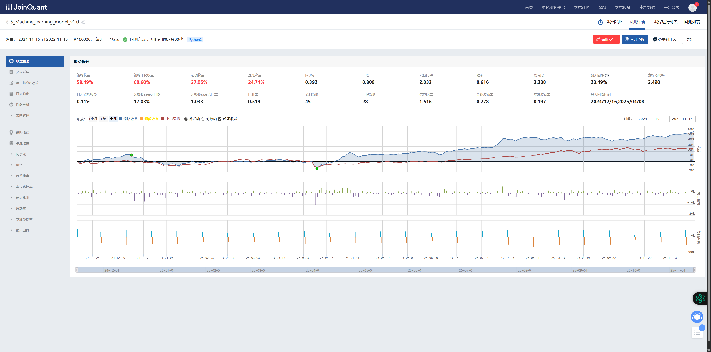
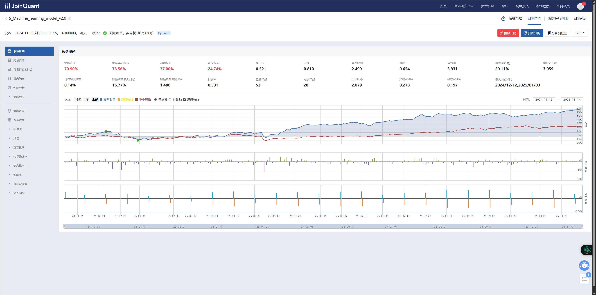

# 5-Model Rolling Ensemble for A-Share Stock Selection (JoinQuant)

**JoinQuant research backtest, benchmark 399101.XSHE, initial capital ¥100,000, 2024-11-15 → 2025-11-15.**

> **v2:** Sharpe **2.499**, return **70.90%**, annualized **73.56%**, excess **37.00%** against a benchmark return of **24.74%**, alpha **0.521**, beta **0.810**, max drawdown **20.11%**.
>
> **v1** on the same window: Sharpe **2.033**, return **58.49%**, annualized **60.69%**, excess **27.05%**, max drawdown **23.49%**.
>
> v1 to v2 on one research window: Sharpe 2.033 to 2.499, return 58.49% to 70.90%, excess 27.05% to 37.00%, max drawdown 23.49% to 20.11%. Five-model rolling ensemble (LightGBM, XGBoost, SVR, Random Forest, Linear), about 79 factors, regime windows of 24 / 36 / 48 months, retrain every ~60 trading days (≈ quarterly), rebalance every 10 trading days, top 5 names.

The strategy runs on JoinQuant (`jqdata`, `jqfactor`). Screenshots: `v2.0.png`, `v1.0.png`. CI compiles `main.py` and `scripts/` with `python -m py_compile` and stays off JoinQuant credentials.




---

## Platform

The strategy runs on JoinQuant (`jqdata`, `jqfactor`). A local research runtime pairs a data provider with the same rebalance clock.

---

# **1. Overview**

This project implements a **multi-model, dynamically weighted ensemble stock-picking system** on JoinQuant.

### **Core idea**
Train **5 machine-learning models** on a rolling window:

- LightGBM 
- XGBoost 
- SVR 
- Random Forest 
- Linear Regression 

Train 5 machine-learning models on a rolling window, then compute a **combined loss
(future-return MSE + 3-class accuracy term)** for each model and use it for **dynamic
ensemble weighting**:

- Lower combined loss → higher weight 
- Persistently poor models → penalized 

Rebalance every **10 trading days**, holding **top 5 high-scoring stocks**, with risk filters on ST names, new listings, and boards.

This is a **framework-oriented** strategy emphasizing:

- Rolling training pipeline design 
- Multi-model dynamic weighting 
- JoinQuant periodic rebalancing workflow 

---

# **2. Platform**

The strategy runs on JoinQuant (`jqdata`, `jqfactor`):

```python
from jqdata import *
from jqfactor import get_factor_values
```

Access to:

- Price data 
- Factor data 
- Index constituents 
- Trading calendar 
- Strategy lifecycle APIs (`initialize`, `run_daily`, `order_target_value`, etc.) 

A local research runtime pairs a data provider and a backtest loop with these APIs.

---

# **3. High-Level Strategy Flow**

### **Initialization (`initialize`)**
- Set benchmark: **399101.XSHE (SZSE SME Composite)**
- Configure slippage & transaction cost 
- Instantiate `MonthlyRolling5ModelStrategy` 
- Load or train model 

Register callbacks:

| Time | Task | Function |
|------|------|-----------|
| 09:00 | Retrain check (~60 trading days) | `check_monthly_retraining` |
| 09:05 | Select universe | `prepare_stock_list` |
| 09:30 | Trading/rebalancing | `trading_logic` |

### **Rolling training — every ~60 trading days (≈ quarterly)**
- Uses a **dynamic training window (24 / 36 / 48 months)** based on recent HS300 volatility; 36 months is the default regime. 
- Compute combined loss (future-return MSE + 3-class accuracy term)
- Update rolling combined-loss window
- Apply penalty for weak models 
- Save model files 

### **Stock Scoring on Rebalancing Days**
- Filter universe 
- Fetch factor values 
- Score via weighted ensemble on rebalancing days, every 10 trading days

### **Periodic Rebalancing (every 10 days)**
- Sell dropped names 
- Buy/hold top N stocks 
- Basic risk filters 

---

# **4. Model Training & Dynamic Weighting**

## **4.1 Rolling Training Logic**

### Training Frequency
- Retrain every **~60 trading days (≈ quarterly)** (configurable)

### Training Data
- Window: Uses a **dynamic training window (24 / 36 / 48 months)** based on recent HS300 volatility; 36 months is the default regime.
- Universe filters:
 - Remove ST stocks 
 - Remove ChiNext/STAR/BSE boards 
 - Remove newly listed stocks (< 90 days) in the training universe
 
### Features (~79 factors)
Categories:
- Fundamental 
- Valuation 
- Technical 
- Risk 

### Labels
- Regression: future return 
- Binary: above/below cross-section median 
- 3-class: return quantiles (25% / 75%) 

### Preprocessing
- Median fill 
- Replace inf 
- Outlier clipping 
- RobustScaler normalization 

### Feature Selection
- Correlation graph (|corr| > 0.6) 
- Keep 1 factor per correlated cluster 

---

## **4.2 Five-Model Ensemble**

Models trained on identical features:

| Model | Advantage |
|-------|-----------|
| LightGBM | Non-linear boosting |
| XGBoost | Stable boosting variant |
| SVR | High-dimensional boundaries |
| Random Forest | Robust ensembles |
| Linear Regression | Stabilizes ensemble |

Each model is evaluated using a **combined loss** (regression MSE on future return + 3-class accuracy), and the dynamic weights are computed from this rolling loss.

---

## **4.3 Dynamic Weighting Formula**

### Rolling combined loss (MSE + 3-class) Window
- Keep last **3 rounds**
- Use average as **rolling combined loss**

### Low-Contribution Penalty
If recent rolling combined loss > 1.5 × mean → **penalty = 0.5** 

### **Weight Formula**


weight_i ∝ (1 / rolling combined loss_i) × penalty_i
Lower combined loss → larger weight
Weak models → explicit penalty

---

# **5. Stock Selection Logic**

### Base Universe
- Index constituents (399101.XSHE)

### Risk Filters
Remove:
- ChiNext / STAR / BSE 
- ST stocks 
- Suspended stocks 

The training universe applies the newly listed filter. Live stock selection on each rebalance applies the ST, suspension, and ChiNext / STAR / BSE board filters.

### Factor Data & Scoring
- Fetch using `get_factor_values` 
- Run ensemble to generate score 
- Higher score → better expected return 

### Final Portfolio
- Sort by score 
- Select **Top 5** stocks 
- If model untrained → fallback baseline selection 

---

# **6. Trading & Rebalancing Logic**

### Rebalance Frequency
- First day → always 
- Then every **10 trading days** 

### Sell Rules
- Names outside the target list are sold 

### Buy Rules
- Equal-weight among target holdings 
- Check liquidity/risk 

### Risk Control
- Fixed number of holdings 
- Low turnover 
- Benchmark tracking 

Rebalancing stays on a fixed 10-trading-day clock, so the research backtest measures the ensemble score.

---

# **7. Result on this research window**

v1 to v2 on one research window: Sharpe **2.033** to **2.499**, return **58.49%** to **70.90%**, excess **27.05%** to **37.00%**, max drawdown **23.49%** to **20.11%**. Five-model rolling ensemble (LightGBM, XGBoost, SVR, Random Forest, Linear), about 79 factors, regime windows of 24 / 36 / 48 months, retrain every ~60 trading days (≈ quarterly), rebalance every 10 trading days, top 5 names, benchmark **399101.XSHE**, initial capital **¥100,000**.

The strategy runs on JoinQuant (`jqdata`, `jqfactor`).

---

# **8. How to Use (JoinQuant)**

1. Log into JoinQuant research environment 
2. Create a new strategy 
3. Copy the entire code into the script 
4. Ensure you have:
 - `jqdata` & `jqfactor` permissions 
 - Read/write local file access 

### **Backtest**
- An empty model store on the first run triggers full training 
- Then rolling training automatically happens per schedule 

---

# **9. Forward roadmap**

The research program ahead builds on the v2 result above.

### **Factor engineering**
- Industry-neutral factors 
- Style factors 
- Alternative data 

### **Model program**
- CatBoost and neural-net members in the ensemble 
- Cross-validation on the rolling window 
- Hyperparameter search inside the same retrain clock 

### **Risk program**
- Industry diversification 
- Volatility-based allocation 
- Dynamic stop-loss 

### **Execution program**
- Slippage model aligned to the printed commission and impact settings 
- Intraday modeling 
- Liquidity constraints 

### **Local research runtime**
- Data provider beside the JoinQuant research APIs 
- Backtest loop for the same 10-trading-day rebalance clock 
- JoinQuant official API for data access 

---

